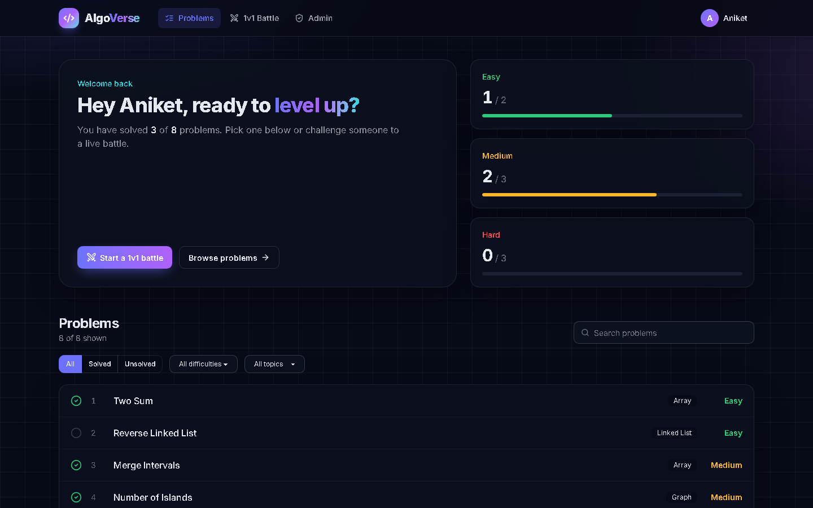
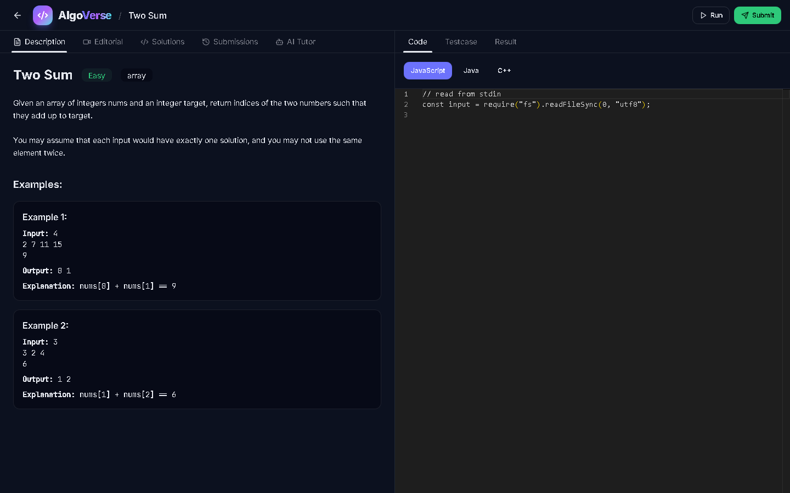
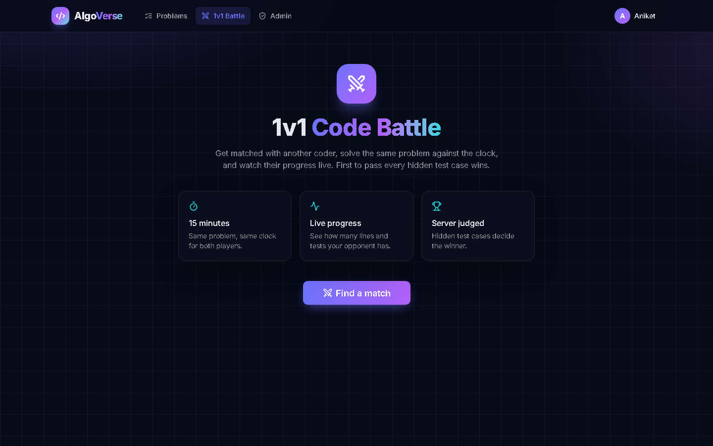
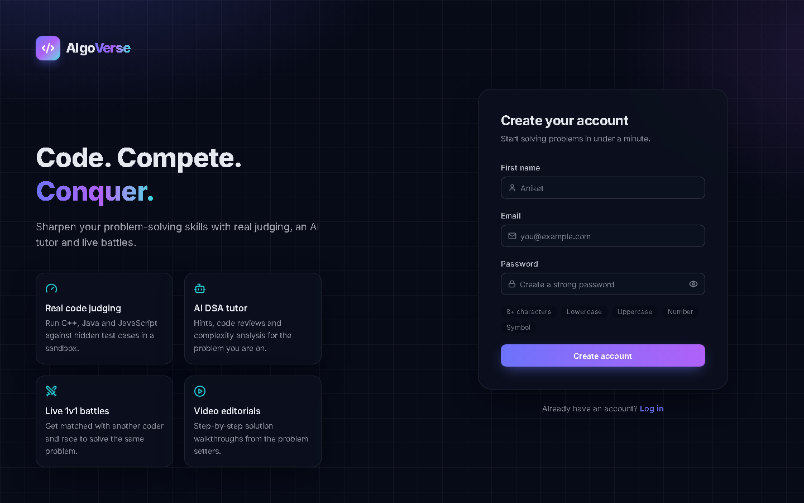
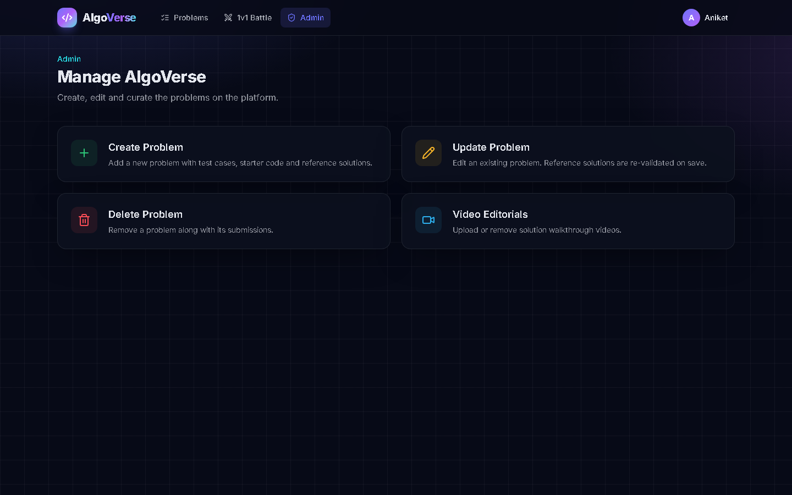

<div align="center">


# AlgoVerse

**Code. Compete. Conquer.**

A full-stack competitive coding platform: solve DSA problems with real sandboxed judging, get hints from an AI tutor, watch video editorials, and race other coders in live 1v1 battles.

[**🚀 Live Demo**](https://frontend-coding-roan.vercel.app/signup)


</div>

---

## ✨ Features

| | Feature | How it works |
|---|---|---|
| ⚙️ | **Real code judging** | Code runs in a sandbox against hidden test cases through **Judge0** (C++, Java, JavaScript). **Run** checks the sample tests; **Submit** checks the hidden ones and records runtime, memory and the verdict. |
| 🤖 | **AI DSA tutor** | **Google Gemini 2.5 Flash** gets the current problem as context and gives hints, code reviews, complexity analysis and alternative approaches. It is limited to DSA help. |
| ⚔️ | **Live 1v1 battles** | **Socket.IO** pairs players, picks a random problem and streams opponent progress live. The **server judges the final code** and decides the winner. Includes a reconnect grace period and a 15-minute timer. |
| 👥 | **Collaborative editor** | Monaco edit deltas sync over Socket.IO, and room state lives in **Redis** so late joiners get the latest code instantly. |
| 🎬 | **Video editorials** | Admins upload solution videos **directly to Cloudinary** with signed upload credentials; the server verifies each upload before saving it. |
| 🔐 | **Secure auth** | bcrypt passwords and a JWT in an **httpOnly cookie**. Logout revokes the token through a **Redis blocklist** that expires with it. Separate **user/admin roles**. |
| 🛠️ | **Admin panel** | Create, update and delete problems. Every reference solution is **validated against Judge0** before a problem can be saved. |
| 📊 | **Progress tracking** | Solved counts by difficulty, search and filters, and full submission history with code, runtime and memory. |

## 📸 Screenshots

| Dashboard | Problem workspace |
|---|---|
|  |  |
| **1v1 Code Battle** | **Sign up** |
|  |  |
| **Admin panel** | |
|  | |

## 🏗️ Architecture

```
React 19 + Vite (Vercel) ──REST + httpOnly JWT cookie──▶ Express 5 API ──▶ MongoDB Atlas
        │                                                   │   ├────────▶ Redis (token blocklist, collab state)
        └────────── WebSocket (/battle, /collab) ──────────▶ Socket.IO  ├────────▶ Judge0 (sandboxed execution)
                                                                ├────────▶ Google Gemini (AI tutor)
                                                                └────────▶ Cloudinary (video editorials)
```

## 📁 Project structure

```
backend-coding/
  src/
    config/        MongoDB, Redis and CORS origins
    controllers/   auth, problems, submissions, AI tutor, videos
    middleware/    user / admin JWT guards
    models/        User, Problem, Submission, SolutionVideo
    routes/        /user /problem /submission /ai /video
    sockets/       Socket.IO auth + /battle and /collab namespaces
    utils/         Judge0 client, validators, Redis room manager
frontend-coding/
  src/
    pages/         Login, Signup, Homepage, ProblemPage, CodeBattle, Admin
    components/    Navbar, AuthLayout, ChatAi, Editorial, SubmissionHistory, admin tools
    store/         Redux Toolkit slices (auth, battle)
    hooks/         useCollabSync (Monaco ↔ Socket.IO)
```

## 🚀 Getting started

**Prerequisites:** Node.js 18+, a MongoDB database, a Redis instance, plus API keys for Judge0 (RapidAPI), Google Gemini and Cloudinary.

```bash
git clone https://github.com/Anikettiw-at/Algoverse---coding-platform.git
cd Algoverse---coding-platform
```

**Backend**

```bash
cd backend-coding
cp .env.example .env    # fill in your keys
npm install
npm run dev             # http://localhost:3000
```

**Frontend**

```bash
cd frontend-coding
cp .env.example .env
npm install
npm run dev             # http://localhost:5173
```

### Environment variables

| Backend | Purpose |
|---|---|
| `DB_CONNECT_STRING` | MongoDB connection string |
| `JWT_KEY` | Secret for signing auth tokens |
| `REDIS_HOST` / `REDIS_PORT` / `REDIS_USER` / `REDIS_PASS` | Redis connection |
| `JUDGE0_KEY` | RapidAPI key for Judge0 CE |
| `GEMINI_KEY` | Google Gemini API key |
| `CLOUDINARY_CLOUD_NAME` / `CLOUDINARY_API_KEY` / `CLOUDINARY_API_SECRET` | Video uploads |
| `FRONTEND_URL` | Extra allowed CORS origins (comma-separated) |

| Frontend | Purpose |
|---|---|
| `VITE_API_URL` | Backend URL for REST calls |
| `VITE_SOCKET_URL` | Backend URL for Socket.IO |

## 🔌 API overview

| Method | Endpoint | Access |
|---|---|---|
| `POST` | `/user/register`, `/user/login`, `/user/logout` | Public / user |
| `GET` | `/user/check` | User |
| `GET` | `/problem/getAllProblem`, `/problem/problemById/:id` | User |
| `POST` | `/submission/run/:id`, `/submission/submit/:id` | User |
| `POST` | `/ai/chat` | User |
| `POST` / `PUT` / `DELETE` | `/problem/create`, `/problem/update/:id`, `/problem/delete/:id` | Admin |
| `GET` / `POST` / `DELETE` | `/video/create/:problemId`, `/video/save`, `/video/delete/:problemId` | Admin |

## 🧠 Engineering highlights

- **Server-authoritative battles** — the client never declares a winner; the server re-runs the submitted code on hidden tests.
- **Token revocation for stateless JWTs** — logout writes the token to Redis with `EXPIREAT` set to the JWT's own expiry, so the blocklist cleans itself up.
- **No broken problems** — every reference solution must pass on Judge0 before a problem can be saved or updated.
- **Direct-to-cloud uploads** — large videos never pass through the Node server; the server only signs the upload and then verifies it.
- **Delta-based collaboration** — only Monaco edit ranges cross the wire; edits are applied with `executeEdits` so remote cursors don't jump.
- **Code-split frontend** — the editor and admin pages load on demand to keep the first load fast.

## 🗺️ Roadmap

- [ ] Redis-backed matchmaking + Socket.IO Redis adapter for multi-instance scaling
- [ ] Judge0 webhooks / job queue instead of polling
- [ ] Rating-based matchmaking and a global leaderboard (Redis sorted sets)
- [ ] Refresh tokens and rate limiting on auth, AI and submit routes
- [ ] CRDT-based (Yjs) collaborative editing for 3+ users

## 👤 Author

**Aniket Tiwari** · [GitHub](https://github.com/Anikettiw-at)
